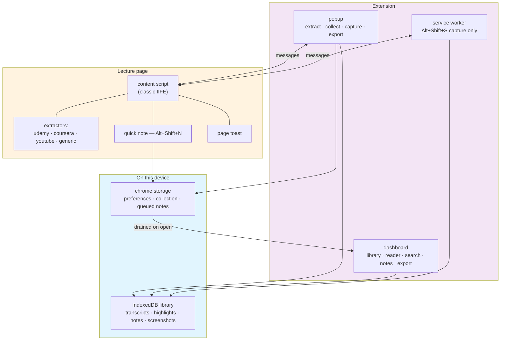

# 🎓 Transcript Extractor

A Chrome extension that turns video lectures into notes you can search, mark up and take
elsewhere — entirely on your own machine.

[](https://chrome.google.com/webstore)
[](https://github.com/pras-ops/udemy-transcript-extractor)
[](LICENSE)

No account, no server, no telemetry. Your library is stored and processed locally.
Extraction may fetch captions and metadata from the source platform using your browser session.

---

## 🎯 The problem

Watching a lecture and keeping notes from it are two activities that fight each other.

- Raw captions are unreadable as notes — no paragraphs, filler words everywhere, one line every two
  seconds.
- Writing a five-word realisation means pausing, alt-tabbing to a notes app, finding the right page,
  typing, and coming back to hunt for your place again.
- Diagrams and code on screen never make it into the transcript at all.
- A month later you remember a concept but not which of forty lectures it was in.
- Udemy ignores `#t=` in its URLs, so a timestamp in your notes is a number you scrub for by hand.

This extension closes that loop: **watch → capture or note without leaving the video → read as
prose → mark a passage → jump back to the exact moment → search every course at once → export.**

---

## ✨ What it does

### Extract

- **One click, any lecture.** Dedicated extractors for Udemy, Coursera and YouTube, plus a generic
  extractor that reads caption data from any standard HTML5 player — Panopto, Kaltura, Echo360,
  Canvas Studio, Moodle, edX and most self-hosted lecture players.
- **Collect a course.** Lectures accumulate as you work through it. Batch collection keeps
  committed progress, offers resume and retry-failed controls, and belongs to its original tab.
  Open the same course or playlist before resuming an interrupted run.
- **Cleanup that matters.** Filler words removed, duplicate and rolling caption lines collapsed,
  out-of-order cues repaired (Udemy's transcript panel is virtualised and hands them over scrambled),
  and technical vocabulary repaired — "Jupiter notebook" → "Jupyter Notebook", "numb pie" → "NumPy".

### Study

- **A reader, not a caption dump.** The transcript is grouped into paragraphs, with a toggle back to
  line-per-cue when you want to see exactly where each one starts.
- **Highlight and annotate.** Mark a passage and it captures the moment it was said, so you never
  type a timestamp. Attach your own note to a highlight — a quote and what you made of it stay one
  thought.
- **Notes while watching.** `Alt+Shift+N` on the lecture page opens a composer over the video. It
  pauses, takes the moment you reacted to, and saves. No alt-tab.
- **Screenshots while watching.** `Alt+Shift+S` captures the frame you are looking at. A transcript
  cannot show a diagram or a line of code; the still can.
- **Jump back to the video.** Every timestamp — in the reader, your highlights, your notes, search
  results — seeks the lecture's player. Duration-based timestamps are labeled approximate.

### Understand

All of this is derived from the transcript by selection and statistics, so nothing is invented:

- **Chapters**, from TextTiling over embedding similarity.
- **Key concepts**, KeyBERT-style with MMR for diversity.
- **Definitions the lecturer actually stated**, matched with Hearst patterns ("X is a Y").
- **Key moments** — the lecturer's own most representative sentences.

### Search

- **Across every course at once**, by meaning rather than exact words. Keyword search is usable
  immediately; the meaning tier loads behind it and upgrades the results.
- Returns **passages with timestamps** rather than a generated answer, so it cannot tell you
  something that was never said.

### Export

- **Study notes (Markdown)** — the transcript with your highlights marked `==inline==`, your notes at
  their moments, and text read off your screenshots in fenced blocks. Or just the digest, without the
  transcript.
- **A whole course** as one document.
- **Ten transcript formats** for everything else.

| Format | Best for |
| --- | --- |
| **Study notes** (`.md`) | Obsidian, Notion, Logseq — your own marks included |
| **Markdown** / **Organised** (`.md`) | Readable notes with timestamps and headings |
| **Obsidian** (`.md`) | Vault-ready, with frontmatter |
| **Plain text** (`.txt`) | Anywhere |
| **Retrieval chunks** (`.json`) | Vector stores, NotebookLM — pre-chunked with context headers |
| **JSON** (`.json`) | Your own scripts |
| **SubRip** (`.srt`) / **WebVTT** (`.vtt`) | Video editors, players, re-upload |
| **CSV** (`.csv`) | Excel, Google Sheets |
| **Anki** (`.csv`) | Cloze cards built from stated definitions |

---

## Download a video beside its transcript

Open a lecture and click the extension icon to open its side panel. Downloads run in **Main**
while the source website stays open. Set Video, Transcript and automatic downloading in **Settings**.
The destination folder is remembered in the Chrome profile. Chrome may ask to renew folder access.

Main automatically loads all available items with every item selected. Uncheck anything you
want to skip, then click **Download**. Completed items are skipped when resuming.
Video and transcript progress are counted separately. A saved video remains counted when its
transcript is unavailable, including after reopening the panel. Retrying that partial item attempts
the missing transcript without downloading its video again.
The small trash button beside a saved item's status removes that row from the current list; it does
not delete saved files. The close button at the top right of a queue stops and dismisses only that queue,
leaving its source tab and saved files intact. It stays dismissed for that collection until the panel is reopened
or the tab moves to another collection.

The compact download card places a preview beside its title, one combined **Video quality** picker,
and a small Download button. Multi-video selection checkboxes sit at the top left of previews. Single videos have no checkbox and appear
directly without a duplicate queue entry or **Videos (1)** list. Only multi-video sources have a lower queue
entry and **Videos** disclosure for item selection and detailed statuses.
After a single video is saved, its format picker, Download button and transfer counters are replaced by
one compact result: video and transcript downloaded, or video downloaded without a transcript.
Single-video failures show a small **Retry** beside the error, without a list-retry block or separate
failure summary. Retry explicitly reloads and reconnects that source tab; it repeats a failed download
only when one had already been requested. Automatic reload remains off unless enabled separately.
The quality menu offers Auto and available MP4/WebM resolutions, limiting advertised renditions to the selected
height. YouTube choices come from the player; for HLS, use **Detect available qualities** to read the master
playlist without downloading media segments. A fixed-quality source stays at its original quality. These
controls select existing streams; they do not transcode or upscale video. Unsupported selections fail clearly.
Quality preferences are saved in the Chrome profile. Each quality selection has separate saved-video progress,
so another quality can be downloaded while reusing a transcript already saved for that video.
Configure the destination folder in Settings. If no folder has been configured, Download shows
an error directing you to Settings. If the saved folder needs renewed access, Download opens
Chrome's native permission dialog and continues immediately when access is granted.
Settings can be opened while downloading without interrupting the job.

The downloader never starts video playback. It reads existing streams and, if needed, asks you to play
the source manually. Automatic mode waits quietly until a stream becomes available. Automatic page reload
is off by default; **Settings → Automatically reload the source page to recover a download** enables bounded
reload/retry for stale scripts, missing streams and transient failures. Text-only pages are skipped for video, with their transcript saved when available.
A player that still has no supported HLS or MP4 stream is reported separately from a page without a player.
Video pages are not skipped just because the player element has not rendered yet.
When transcript extraction fails, the video is still saved and the item reports a partial result;
the queue continues with the remaining items. Transcript-only downloads still report extraction failures.
The queue continues past unsupported items and pauses for permission, authentication, subscription
or cancellation events. Keep the side panel open until downloads finish.

HLS MPEG-TS and fragmented MP4 are saved as standard MP4 with their original audio/video tracks.
Direct MP4 is saved as supplied. Standard AES-128 HLS is supported. DRM, SAMPLE-AES, DASH, live streams,
separate audio/video playlists and discontinuities requiring additional remuxing remain unsupported.

### YouTube downloads

Open a YouTube watch page or Short in the Chrome profile where you are signed in, then open the
extension. The same Download action, destination folder, automatic mode and playlist selection are used.
The **Download queues** list keeps an independent queue for each source tab. Switching between YouTube
and Udemy tabs selects that tab's queue without cancelling downloads or permission pauses in other tabs.
Supported video tabs in the current window are detected and registered automatically, including new background tabs.
Select a queue and press **Download**;
different queues can transfer concurrently. When automatic mode is enabled, registered video tabs are
watched independently. A host grant is reused by other waiting queues. Only the selected queue shows its
permission dialog, so a background queue does not interrupt another queue's controls.
Folder and format settings are shared; they cannot be changed during active transfers. Queue snapshots
are stored separately by source tab, with existing saved-artifact progress retained. Closing a source tab
removes its waiting queue immediately. A transfer already prepared and running inside the extension may finish
without the source tab; it never opens the next item or reloads the closed tab, and is removed when finished.
Keep the extension panel open during transfers; closing or reloading it stops its workers.
Playlist pages work before opening a video, and watch-page playlist navigation retains its playlist ID.
The extension reads existing playlist rows first. If more rows are needed and the playlist has an internal
overflow container, only that container is scrolled and its position restored. The page viewport is never
scrolled. Without an internal scroller, the loaded subset remains available with a warning. It compares the loaded
count with YouTube's declared count when available. Incomplete lists show a warning and **Load remaining items**
while still allowing the loaded selections to download;
duplicates are counted as unique downloads and unavailable entries remain visible as skipped items.
Automatic mode waits for a video page; it does not try to download the playlist page as a video.

The extension reads formats from the current page's player and correlates them with requests the player
has already made. Requests use the current Chrome session; cookies are not exported to a local application
or sent to a separate download server. Extra CDN hosts use the existing access dialog.

Progressive files and separate video/audio files are downloaded in bounded byte ranges, validated for
completeness, and combined inside the extension. AVC/AAC is preferred when available; MP4 and WebM
outputs retain the original codecs. Temporary track files are removed on success, failure or cancellation.
Transcript failures do not prevent saving the video.

SABR/UMP playback uses a bundled protocol reader and the current player's captured request context.
A small observer runs at document start on YouTube and leaves the player's requests and responses unchanged.
The playback context stays in memory and is not included in settings, queue records or logs. A page already
open before the extension update may need a manual reload to load the observer (or the optional automatic-reload setting). Both tracks are consumed
concurrently, checked against the advertised duration, and combined using the same browser-only muxer.
Track types are recognized from MIME metadata even when optional quality labels are absent.
If a saved format or resolution is unavailable but Auto has a compatible pair, the error offers
the small **Retry** action to reset quality to Auto and try again. Missing tracks are reported separately.
Format discovery reads up to three snapshots when no usable quality appears. The explicit **Detect available
qualities** action can reload once before its final attempt only when automatic reload is enabled in Settings.
It never reloads during a download. Progress, combining details and Cancel stay inside the source card;
the state label appears below its thumbnail.

This does not evaluate downloaded player scripts, invent missing signatures, mint proof tokens, bypass DRM,
or run the Python/Node/FFmpeg backend used by a desktop downloader. If the player's current session cannot
be captured, the error includes counts and observer state without credentials. Live account playback still
needs verification in Chrome before release; fixture and decoder tests do not establish that every
YouTube video can be downloaded.

Implementation references: [Chrome scripting](https://developer.chrome.com/docs/extensions/reference/api/scripting),
[Mediabunny media writing](https://mediabunny.dev/guide/writing-media-files).
SABR protocol reader: [GoogleVideo](https://github.com/LuanRT/googlevideo) (MIT, bundled locally).

### Download diagnostics

Open the gear button → **Diagnostics** → **Download diagnostic log** to save a JSON support file.
Recording starts with this version and persists in the Chrome profile. Runs include a numeric source-tab ID
to distinguish concurrent queues without storing page URLs. The bounded log retains permission
requests/results, CDN origin patterns, response codes, retries and saved-file status.
Format-selection failures also record the selected quality, track counts and whether Auto can work.
It excludes cookies, tokens, signed URLs, headers, video titles, transcripts and folder paths. Routine network events are removed
first when the 1,000-entry limit is reached, preserving permission and result events where possible.

HTTPS network access (`https://*/*`) is declared as a required installation permission, including CDN hosts
not known ahead of time. Chrome may ask for approval when installing or updating this permission;
downloads reuse that grant without asking for each video or server. No optional host permission is declared.
If site access is deliberately withheld in Chrome, access must be restored before downloading.
Existing grants are checked through Chrome;
folder permission is requested only if Chrome reports it is not already granted. The application access
dialog and Chrome's native confirmation can both appear during an initial grant. The log distinguishes
host access, folder access and server failures after permission has been granted.
Incomplete video files are removed after a failure.

Preferences, the folder handle, progress and installation ID remain in the same Chrome profile
across updates with the same extension ID. Removing the extension or clearing its storage removes them.
Subscription polling runs at a fixed 15-minute interval in the background while Chrome is running.
The API is currently a local simulator with active, expired, revoked and device-limit responses.
Real account authentication and enforcement across devices require the future server API.

After updating the unpacked extension, reload it in `chrome://extensions`. Clicking the icon opens
the Main/Settings side panel alongside the website.

---

## 🧠 Why there is no language model in here

This is the most consequential decision in the project, and it is worth explaining properly —
especially because the answer is *not* "we switched to Google's AI".

### What was here before

Version 3 shipped **WebLLM**: a real language model running inside the browser. It worked, and it
was unshippable.

- A **multi-gigabyte model download** before the first use.
- **WebGPU required** — absent on a large share of the machines students actually own.
- A **WASM runtime**, which forced `'wasm-unsafe-eval'` into the extension's CSP.
- It fetched a compiled `.wasm` library **from a CDN at runtime**. Manifest V3 forbids remotely
  hosted code and the Chrome Web Store counts WASM as code, so this alone made the extension
  impossible to publish.
- Four high-severity dependency vulnerabilities came along with the runtime.

### What replaced it

Rather than find a smaller model, 4.2.0 asked what the model was actually *for* and split it in two.

**Tier one — statistics, and it works on every machine.**

Search uses **Model2Vec `potion-base-8M` static embeddings**, which is a lookup table rather than a
model. Embedding a token is an array index, not a forward pass. That means no inference runtime, no
WASM, no GPU, and identical speed on a ten-year-old laptop. The table ships *inside* the extension
package (~30 MB), so nothing is downloaded and nothing is fetched at runtime.

Everything in **Understand** above is built on the same footing — TextTiling, MMR, Hearst patterns,
extractive summarisation. All selection, no generation. None of it can hallucinate, because none of
it writes anything.

**Tier two — Chrome's own on-device model, optional.**

Two features genuinely need generation: prose summaries, and reading text off a captured frame.
Those use **Chrome's built-in on-device model (Gemini Nano)** through the Summarizer and Prompt APIs.

This is where Google comes in, and the distinction matters:

- The extension **does not ship or download a model**. Chrome owns it as a browser feature.
- **Nothing leaves your machine.** The model runs locally; your screenshots and transcripts are not
  sent to Google or anyone else.
- It is **probed, never assumed** (`probeSummarizer`, `probeImageModel`). Where the browser or
  hardware does not support it, those two features are simply not offered, and everything else is
  unaffected.

Be aware of the consequence: **most users will not have tier two.** It needs a recent Chrome,
capable hardware, and a one-time model download that Chrome manages. The features that work
everywhere are search, the reader, chapters, concepts, definitions, extractive summaries, seek and
every export.

`npm run check:store` enforces the no-remote-code property on every single build, so this cannot
quietly regress.

---

## 🏗️ Architecture

Four contexts, each with one job.



Two details that are load-bearing rather than incidental:

**The service worker has exactly one job.** Capturing a frame needs
`chrome.tabs.captureVisibleTab`, and a content script has no `chrome.tabs` at all. The `activeTab`
permission it depends on is only granted when the user *invokes* the extension — a keypress on the
page is not that, but a `chrome.commands` shortcut is. That is the entire reason the worker exists.
Notes need no such thing, which is why `Alt+Shift+N` is a plain listener on the page.

**Notes written on the page cannot reach the library directly.** A content script's `indexedDB` is
the *site's*, not the extension's — writing there would file a note about a lecture into Udemy's
storage, where nothing would ever read it. So notes queue in `chrome.storage` and the dashboard
drains them when it opens. A note survives closing the tab, the browser, or the machine, but it
appears in the dashboard the next time you open it rather than instantly.

📖 **Full detail in [docs/TECHNICAL.md](docs/TECHNICAL.md)**

---

## 🛠️ Installation

### Chrome Web Store

Coming soon.

### Load unpacked

1. Download the latest release zip and extract it
2. Open `chrome://extensions/`
3. Enable **Developer mode**
4. **Load unpacked** → select the extracted folder
5. Pin the extension to your toolbar

### Build from source

```bash
git clone https://github.com/pras-ops/udemy-transcript-extractor.git
cd udemy-transcript-extractor
npm install

# Fetch the bundled search model (~30 MB, one time).
# The weights are a build input and are not committed.
npm run fetch:model

# Typecheck, lint, test
npm run verify

# Build, then check against Chrome Web Store rules
npm run deploy

# Load the dist/ folder at chrome://extensions
```

| Script | What it does |
| --- | --- |
| `npm run fetch:model` | Downloads the search model into `public/models/` |
| `npm run verify` | Typecheck + lint + tests |
| `npm run build` | Typecheck, then the popup, content script and worker bundles |
| `npm run build:extension` | Production build plus manifest, icons and model assets |
| `npm run check:store` | Fails if anything would be rejected by the store |
| `npm run deploy` | `build:extension` then `check:store` |

📖 **See [docs/INSTALLATION.md](docs/INSTALLATION.md)**

---

## 📖 Using it

### Extract

1. Open a lecture and make sure its transcript panel is open — the extension reads what the player
   renders, it does not transcribe audio itself
2. Click the extension icon → **Extract transcript**
3. Collect the course, or extract individual videos. Reopen the popup to resume or retry failed items.

### While watching

| Shortcut | Does |
| --- | --- |
| `Alt+Shift+N` | Write a note against the current moment |
| `Alt+Shift+S` | Capture the frame on screen |

Both pause the video, take the moment, and resume. Rebind them at
`chrome://extensions/shortcuts` — and check there first if one does nothing, because Chrome drops a
conflicting shortcut without warning.

### Review

Open the dashboard from the popup for the library, the reader, cross-course search, your highlights
and your notes. Click any timestamp anywhere to send the lecture's player back to that moment — the
lecture tab needs to be open, and if it is not, the extension opens it.

📖 **See [docs/USAGE.md](docs/USAGE.md)**

---

## 🎯 Supported platforms

**Dedicated extractors** — Udemy, Coursera, YouTube.

**Everything else** — a generic extractor reads caption data directly rather than scraping any
site's markup, using the browser's own `TextTrack` API, `<track>` elements and the caption files the
player fetches. That covers most lecture-capture and LMS players with **no extra permissions**.

If a platform serves captions through a protected endpoint, the extension says so rather than
failing silently.

---

## ⚠️ Known limitations

Worth knowing before you rely on it:

- **Back up your library.** Use **Download backup** in the library sidebar. The versioned JSON
  file includes transcripts, notes, highlights, completion metadata, and PNG screenshots.
  **Restore backup** validates the file and previews counts before merging; existing IDs are kept.
  Files larger than 250 MB are refused. Browser preferences and active collection jobs are not
  included. Clearing browser data or uninstalling still removes the local library.
- **One machine.** There is no sync, by design — but that does mean your notes are where you made
  them.
- **DRM blocks frame capture.** A protected player returns a black rectangle rather than an error.
  The extension detects that and tells you capture is unavailable, rather than filling your notes
  with black images.
- **Tier-two AI is often absent.** See above — OCR and prose summaries need Chrome's on-device
  model.
- **The extractors depend on other people's markup.** A site redesign can break extraction. That is
  the fragile part of this project and always will be.

---

## 🔒 Privacy

Everything runs on your machine, and the build enforces it:

- No library uploads or analytics; source-platform caption requests may occur during extraction
- No telemetry, analytics, crash reporting or remote configuration
- No account, ever
- Required network access covers all HTTPS hosts at installation; automatic content scripts stay limited
  to Udemy, Coursera and YouTube. `check:store` checks both policies and rejects all-protocol host grants
- CSP is `script-src 'self'` — no `wasm-unsafe-eval`, because nothing evaluates generated code

📖 **Full policy in [PRIVACY.md](PRIVACY.md)**

---

## 🔧 Stack

| Layer | Choice |
| --- | --- |
| UI | React 19, TypeScript (strict), Tailwind, Lucide |
| Extension | Chrome Manifest V3 |
| Build | Vite (three configs — popup, content script, worker), Vitest |
| Search | Model2Vec static embeddings + BM25, fused with RRF |
| Storage | IndexedDB for the library, `chrome.storage` for preferences |

**Requirements:** A current desktop Chrome release. Older Chrome versions are not certified by
this project. Optional on-device AI additionally depends on browser APIs and supported hardware;
capabilities are probed before they are offered. Use Node 22 or newer for development and tests.

---

## 📊 Status

**v4.3.0 development checkout** — run `npm run verify` and `npm run deploy` for current results.
Automated checks do not certify live platform compatibility or Chrome Web Store acceptance.

### Development philosophy

- **Simple over clever** — a small amount of code that works beats a general mechanism
- **Local-first** — if a feature needs a server, it is the wrong feature
- **Selection over generation** — never invent something the lecturer did not say
- **Degrade honestly** — a feature that cannot work is not offered, rather than failing when pressed

---

## 🔮 What's next

1. **Paid-beta validation** — test resumable collection and recovery with representative users.
2. **Honest extraction failure** — when a site redesign breaks a selector, say *"the site changed,
   update the extension"* rather than returning nothing.
3. **More captured fixtures** — one sanitized Udemy caption panel is included; Coursera and successful YouTube extraction still need live coverage. See
   [docs/TECHNICAL.md](docs/TECHNICAL.md).
4. **Onboarding validation** — the library now includes a Getting started guide; validate it with new users.
5. **More platforms** — LinkedIn Learning, Khan Academy, on request.

---

## 🤝 Contributing

Fork, branch, `npm run verify`, pull request.

Most useful areas: platform extractors and their fixtures, export formats, and anything that makes
failure more legible.

📖 **Architecture and setup in [docs/TECHNICAL.md](docs/TECHNICAL.md)**

---

## 📄 License

MIT — see [LICENSE](LICENSE).

## 📝 Changelog

Release history in **[CHANGELOG.md](CHANGELOG.md)**.

## 📞 Support

Issues and feature requests on GitHub. 📧 jacobprashant20@gmail.com

---

**⭐ If this saves you time, a star on GitHub is appreciated.**


## Script chạy và đóng gói

[scripts/README.md](scripts/README.md) mô tả các entrypoint `.sh`/`.ps1`, `-f`, `--stop`, `--clean` và prerequisites.
